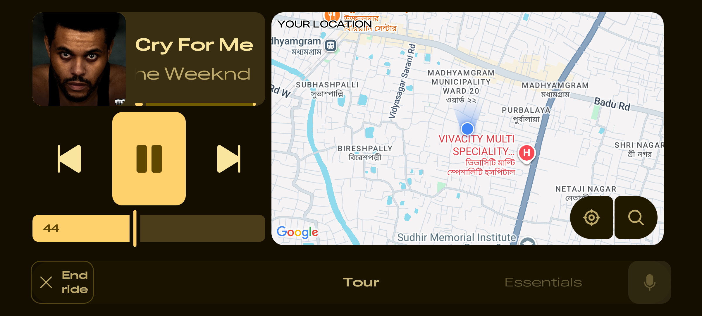
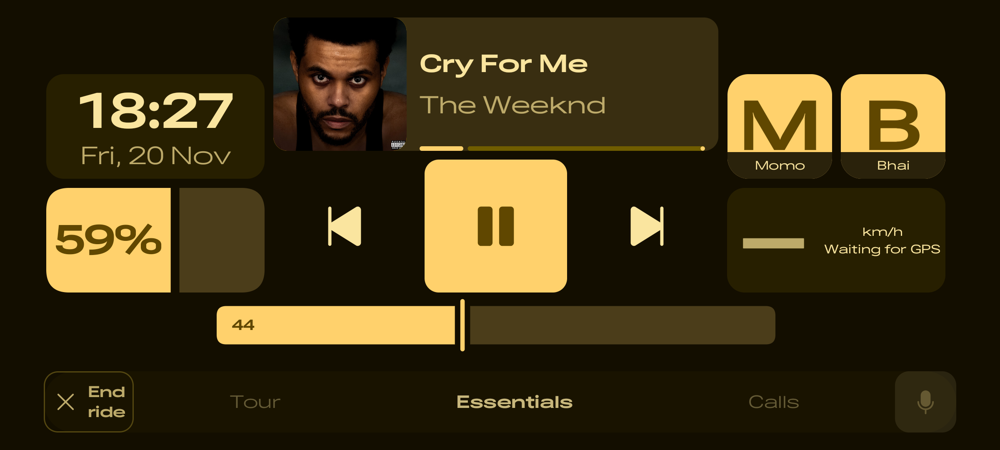
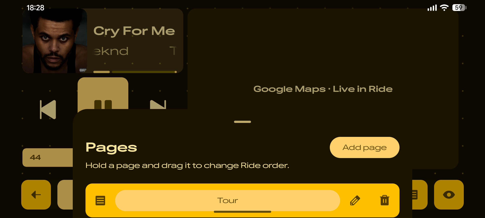
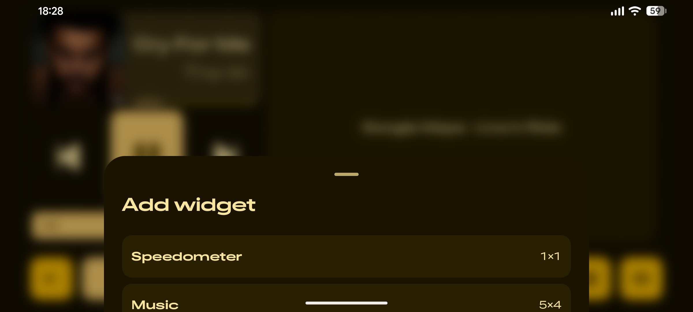
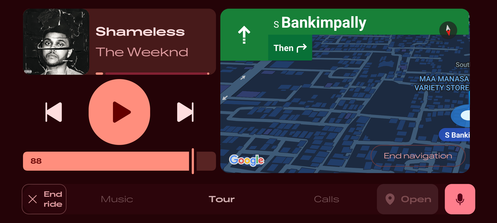
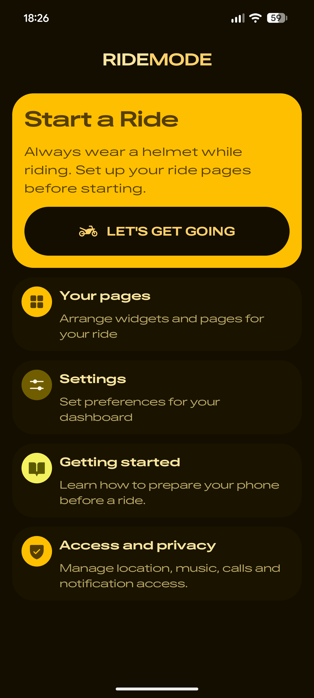
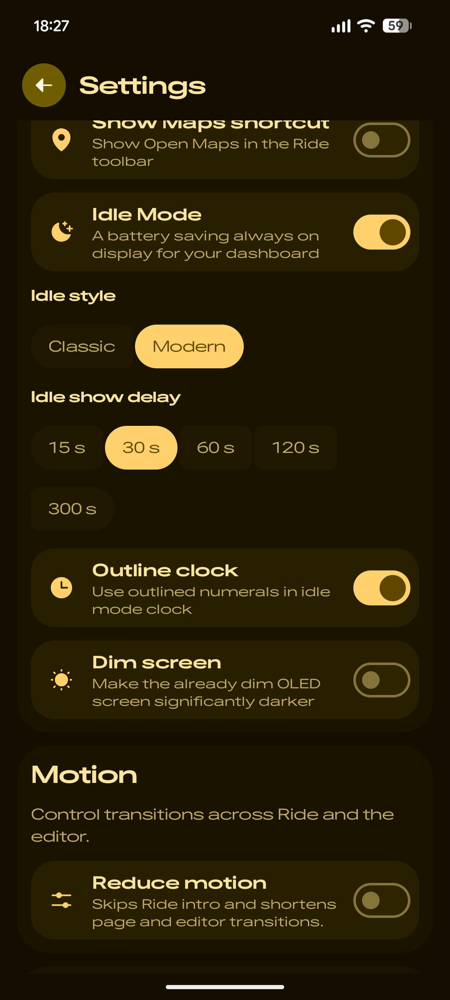

# Ridemode

> **Android-first motorcycle ride companion and customizable dashboard for handlebar-mounted phones.**

Ridemode turns your Android phone into an intelligent, glove-friendly motorcycle cockpit. Built from the ground up with Jetpack Compose and Material 3 Expressive, Ridemode features a customizable landscape dashboard grid, high-contrast glanceable widgets, an AOD battery saver mode, and seamless ride continuity via Picture-in-Picture (PiP) and ongoing notifications.

<p align="center">
  
</p>
<p align="center">
  <em>Live landscape motorcycle cockpit: Integrated Google Maps overview alongside Music controls, dynamic volume slider, and bottom Ride navigation rail.</em>
</p>

---

## ⚡ Highlights

- **Home Menu Grid**: The original Home hero and neutral menu-card styling, with the four lower options arranged in a grid that adapts to width and text size.
- **Customizable Landscape Dashboard**: Organize your cockpit across multiple pages on a device-wide grid with square cells (minimum 6 rows × 12 columns). Drag, resize, add, duplicate, and reorder widgets with live visual feedback.
- **12 Specialized Ride Widgets**: High-contrast, glanceable widgets tailored for riding—from live GPS speed to integrated Google Maps navigation, media controls, weather, and emergency contacts.
- **Glove-Friendly Touch Targets & Safe Confirmations**: Critical actions (ending a ride, placing emergency calls, stopping navigation) use large 80–96 dp touch targets paired with container-free confirmation content fading in and out over a dimmed screen/widget (immediate with Reduce motion) and an animated 5-second countdown to prevent accidental touches on bumpy roads.
- **AOD Battery Saver**: An ambient true-black (`#000000`) screen with configurable idle timeout (15–300s) displays time, live music, battery, and weather while minimizing power draw on AMOLED screens. OLED idle automatically dims the Ride window and its content; **Dim screen** makes it substantially darker. First touch safely wakes the screen and restores normal brightness.
- **Ride Continuity**: Seamless backgrounding via system Picture-in-Picture (PiP) and an ongoing Ride notification with Android Live Update promotion so you never lose your dashboard state.

| Ride Safety Intro Animation | Essentials Multi-Widget Dashboard |
|:---:|:---:|
|  |  |
| *2.4-second upward safety reveal on ride start* | *Glanceable dashboard with Clock, Battery, Music, Volume, SOS Contacts, and Speedometer* |

---

## 🧩 Dashboard Widgets

Ridemode includes 12 active widget types designed specifically for landscape motorcycle use:

| Widget | Description & Capabilities | Sizing (Min / Default / Max) |
|---|---|---|
| **Speedometer** | Live foreground GPS velocity with adaptive number sizing, unit selection (km/h or mph), and satellite fix indicators. No speed history is ever stored. | 1×1 / 3×3 / Full Grid |
| **Google Maps Navigation** | Full in-app turn-by-turn navigation powered by the Google Maps Navigation SDK and Places API (New). Features India-aware Places search, map-pin destination selection, route overview, remaining time/distance/ETA footer, turn guidance header, and voice volume controls. | 4×4 / 6×4 / Full Grid |
| **Turn Guidance** | Passive, notification-derived direction cues captured from ongoing navigation apps (e.g., background Google Maps). Features oversized Phosphor Bold maneuver arrows, distance to turn, arrival time, and a 5-second tap confirmation to open Google Maps. | 4×4 / 7×4 / 7 × Grid Height |
| **Music Player** | Seamless control over your active Android media session (Spotify, YouTube Music, etc.). Displays track title, artist, live album artwork, playback progress bar, and animated play/pause buttons. Song and artist retain size-based typography; overflowing lines marquee only while playing, with faded edges and a one-second initial/repeat pause. Tapping artwork or details when music is playing confirms before opening the active player; when no music is playing, it opens the system "Open with" chooser sheet for all music player apps on the device. | 5×4 / 8×4 / 12×12 (Square/Landscape) |
| **Volume Control** | Dynamic-color segmented volume bar controlling `AudioManager.STREAM_MUSIC`. Synchronizes instantly with device hardware volume buttons and Bluetooth intercom controls. | 2×1 (or 1×2) / 4×1 / Full Width × 24 |
| **Clock & Weather** | Large glanceable local time and date. At 3 or more rows, it automatically includes live weather forecasts, temperature, and condition icons fetched via Open-Meteo with an intelligent 2-hour offline cache. | 2×1 / 4×3 / 12×24 |
| **Battery Status** | Horizontal or vertical segmented battery gauge displaying live system charge percentage and charging status, designed to fit cleanly along dashboard edges. | 2×4 (or 4×2) / 4×2 / 12×24 |
| **SOS Emergency Contacts** | Quick-dial up to 6 custom emergency contacts with personalized photos/initials. Requires explicit confirmation before initiating a call to prevent pocket dials. | 2×2 / 6×3 / 12×6 |
| **Recent Calls** | Displays your 5 most recent phone calls with contact names, timestamps, and one-tap confirmed redialing. | 4×5 / 6×5 / Full Grid |
| **Notifications Feed** | Scrollable feed of active Android notifications prioritizing messages and urgent alerts with sender avatars and timestamps. Includes a quick Privacy mode switch to mask sensitive details. | 4×5 / 6×5 / Full Grid |
| **Voice Assistant** | High-visibility one-tap launcher that triggers your phone's configured default voice assistant (Google Assistant, Gemini, etc.) without requiring microphone permissions in Ridemode. | 2×1 / 3×2 / 6×3 |
| **Maps App Shortcut** | Direct quick-launcher tile to jump straight into the full external Google Maps application. | 2×1 / 3×2 / 6×3 |

---

## 🎨 Dashboard Customization & Page Management

Ridemode features an interactive landscape dashboard editor that lets riders tailor their display to their specific riding style—whether commuting through city traffic or embarking on cross-country touring.

| Multi-Page Management | Add & Arrange Widgets |
|:---:|:---:|
|  |  |
| *Dedicated Page Manager to add, reorder, and manage multiple ride pages* | *Scrollable bottom sheet to add widgets onto the device-wide square grid* |

- **Hold & Drag Reordering**: Arrange multiple pages (e.g., "Tour", "Essentials", "Calls") and reorder them by holding and dragging page rows in the Page Manager.
- **8-Direction Widget Resizing**: Fine-tune widget dimensions on the dotted grid using touch-friendly corner and edge resize handles.
- **Single-Widget Displacement**: Move a widget into an occupied position, and the existing widget automatically shifts to the nearest available space.

---

## 🗺️ Google Maps Widget & API Key Setup

Ridemode features a fully embedded in-app navigation widget powered by the official **Google Maps Navigation SDK for Android** and the **Places API (New)**.

<p align="center">
  
</p>
<p align="center">
  <em>Active in-app navigation: Turn-by-turn guidance, remaining distance/ETA footer, and 3D map rendering running concurrently with media and volume controls.</em>
</p>

To enable the interactive Google Maps widget when compiling the app, configure your Google Cloud API keys in a local `.env` file.

> [!NOTE]
> If you do not configure Google Maps API keys, all other local and offline widgets (Speedometer, Music, Volume, Clock, Weather, Battery, SOS Contacts, and Turn Guidance) will continue to work normally. Only the in-app Google Maps widget will be disabled.

### 1. Configure Your `.env` File

Copy the provided template [.env.example](.env.example) in the root of the repository to a new file named `.env`:

```bash
cp .env.example .env
```

Open `.env` in your text editor:

```env
NAVIGATION_API_KEY=insert_google_nav_api_key
PLACES_API_KEY=insert_google_places_api_key
```

### 2. Obtain Google Cloud API Keys

1. Go to the [Google Cloud Console](https://console.cloud.google.com/).
2. Create a new Google Cloud project (or select an existing one) and ensure that **billing is enabled**.
3. Enable the required APIs under **APIs & Services → Library**:
   - **Navigation SDK**
   - **Places API (New)**
4. Create API keys under **APIs & Services → Credentials**:
   - Create a key for navigation and assign it to `NAVIGATION_API_KEY`.
   - Create a key for places search and assign it to `PLACES_API_KEY` (you may also use the same key for both).
5. **API Key Restrictions (Recommended)**:
   - Restrict the keys to **Android apps**.
   - Add your package name: `com.kapav.ridemode` (default package name)
   - Add your signing certificate's **SHA-1 fingerprint** (for debug builds, obtain this via `./gradlew signingReport` or your local Android debug keystore).
   - Under API restrictions, restrict `NAVIGATION_API_KEY` to the *Navigation SDK* and `PLACES_API_KEY` to the *Places API (New)*.
6. Paste the generated keys into your `.env` file and save.

> [!IMPORTANT]
> The `.env` file is included in [.gitignore](.gitignore) to ensure your private API keys and credentials are never committed to version control.

---

## 🚀 Getting Started & How to Use

> [!NOTE]
> **GitHub Releases**: There are currently no pre-built APK releases published on GitHub yet, but official binary releases will be available soon! In the meantime, you can easily build and install Ridemode from source using Android Studio or the Gradle wrapper.

| Home & Ride Launcher | Settings & Ambient Display |
|:---:|:---:|
|  |  |
| *Original Home styling; lower options now use a grid* | *Comprehensive preferences for OLED power-saving idle mode and motion* |

### Prerequisites

- **Android Device**: Running Android 7.0 (API 24) or higher (reference testing device: Pixel 8a running Android 14+ / API 34+).
- **Handlebar Mount**: Recommended landscape motorcycle phone mount with vibration dampening.
- **Development Environment**:
  - JDK 17 (recommended: OpenJDK 17)
  - Android SDK with API 36 platform and build tools installed
  - Android Studio (Ladybug / Meerkat) or Gradle command-line tools

### Building & Installing from Source

1. **Clone the repository**:
   ```bash
   git clone https://github.com/kapav/ridemode.git
   cd ridemode
   ```

2. **Configure environment keys** (optional for maps):
   ```bash
   cp .env.example .env
   # Add your Google Maps keys as described above
   ```

3. **Build the debug APK**:
   ```bash
   ./gradlew :app:assembleDebug
   ```
   The compiled APK will be generated at:
   `app/build/outputs/apk/debug/app-debug.apk`

4. **Install directly to a connected Android phone**:
   ```bash
   ./gradlew :app:installDebug
   ```
   *(Or simply open the project in Android Studio and click **Run**).*

### First Run & Setup

1. **Launch Ridemode** on your phone.
2. **Grant Permissions**: Go to **Settings → Access and Privacy** to configure permissions:
   - **Location**: Required for the live Speedometer, local weather updates, and Google Maps navigation.
   - **Notification Listener Access**: Required for the Music widget (reading active media sessions) and Turn Guidance (parsing external navigation notifications).
   - **Phone & Call Log** *(optional)*: Required if you wish to use the Recent Calls widget and direct one-touch dialing.
3. **Customize Your Dashboard**:
   - Tap **Your pages** from the Home screen or enter edit mode.
   - Tap any widget to resize with 8-direction handles, move it to open grid cells, or tap **Widget settings** to configure widget-specific options (e.g., choosing SOS contacts or speedometer units).
   - Tap **Add widget** to bring up the widget sheet and add tiles to your layout.
   - Create multiple pages for different riding scenarios (e.g., Daily Commute, Long Touring, Night Ride).
4. **Start Your Ride**:
   - Tap **LET'S GET GOING** on the Home screen.
   - The signature safety animation (*RIDE HARD → SAFE*) will play, smoothly transitioning into your cockpit.
   - Swipe horizontally to switch between dashboard pages.
   - When idle, the OLED screen saver will activate to conserve battery; tap anywhere to return to your dashboard.

---

## 🔒 Permissions & Rider Privacy

Ridemode is built with rider privacy and offline reliability in mind:

| Permission | Purpose & Scope |
|---|---|
| `ACCESS_FINE_LOCATION` / `ACCESS_COARSE_LOCATION` | Used in the foreground exclusively when Ride mode is active to drive the Speedometer and Google Maps navigation. Location is never uploaded or shared with third-party tracking services. Weather uses rounded approximate coordinates sent directly to Open-Meteo. |
| `NotificationListenerService` | Allows the Music widget to display track metadata/artwork from your local media player, and allows Turn Guidance to read incoming navigation cues. All processing occurs locally on-device. |
| `READ_CALL_LOG` & `CALL_PHONE` | Optional; used strictly to populate the 5 most recent calls in the Calls widget and initiate user-confirmed calls from SOS and Recents. (Note: Due to Google Play policies regarding call log access, releases containing this feature are intended for direct APK installation). |
| `POST_NOTIFICATIONS` | Displays the ongoing Ride status notification and allows system Live Update promotion so Ride controls remain accessible when minimized. |
| `INTERNET` | Used strictly for Google Maps navigation tiles, Places search, and Open-Meteo weather fetches. Core pages, speedometer, media controls, and dashboard layouts work 100% offline. |

---

## 📊 Implementation Status & Roadmap

Ridemode is actively developed under a structured milestone roadmap ([docs/ROADMAP.md](docs/ROADMAP.md)).

| Area | Implemented Now | Planned |
|---|---|---|
| **Core Architecture** | Single-module `:app` architecture, Jetpack Compose, Material 3 Expressive theme, Hilt dependency injection, Room layout persistence, DataStore preferences, and unit/lint test coverage. | Production release signing, automated CI pipeline. |
| **Dashboard & Grid** | Device-wide square grid (minimum 6×12), drag-and-drop placement, 8-handle resizing, page manager (add, rename, reorder, delete), fixed landscape Ride canvas, swipe pagination, and animated page indicator. | Custom grid themes, additional layout templates. |
| **Widgets** | 12 active registered widgets: Speedometer (km/h & mph), Google Maps Navigation (Navigation SDK 6.3.3 + Places), Turn Guidance, Music Player (session listener + provider handoff + open-with chooser), Volume Slider, Clock & Weather, Battery Gauge, SOS Emergency Contacts (per-widget contact snapshots), Recent Calls, Notifications Feed, Voice Assistant, and Maps Shortcut. | Local offline voice recognition (M3), motorcycle lean-angle telemetry. |
| **Safety & Controls** | Glove-friendly touch targets (80–96 dp), animated 5-second countdown confirmation bars for calls, navigation stop, and ending rides; startup safety helmet reminder. | Crash detection integration. |
| **Ambient Saver** | True-black OLED power saver with configurable idle timeout (15–300s), selectable Classic and stacked Row styles, live/cached weather, music metadata, battery level, and single-touch wake. | Additional ambient watchface styles. |
| **Ride Continuity** | Android Picture-in-Picture (PiP) support and ongoing notification with Open/End Ride actions. | Android Auto integration exploration. |

---

## 🛠️ Developer Verification & Commands

The project enforces strict verification via Gradle tests, Android lint, and documentation parity checkers:

```bash
# Validate documentation links, JSON contracts, and Kotlin widget registry parity
bash scripts/verify-docs.sh

# Run unit tests and lint checks
./gradlew --no-daemon :app:testDebugUnitTest :app:lintDebug

# Assemble the debug APK
./gradlew --no-daemon :app:assembleDebug
```

### Last Verified Build Result
- **Status**: **PASS** (Exit Code: 0) on 2026-11-20
- **Environment**: Android Studio JBR 21, Android SDK API 36, Navigation SDK 6.3.3, Kotlin 2.1.21
- **Suite**: 55 JVM unit tests passed, Android Lint passed, debug APK successfully assembled.

---

## 📚 Project Documentation

For in-depth technical documentation, architectural specifications, and decision records, explore the `docs/` directory:

- [docs/PRD.md](docs/PRD.md) — Product Requirements Document and MVP scope.
- [docs/ROADMAP.md](docs/ROADMAP.md) — Milestone tracking and task completion status.
- [docs/ARCHITECTURE.md](docs/ARCHITECTURE.md) — System architecture, data flow, and module structure.
- [docs/DESIGN_SYSTEM.md](docs/DESIGN_SYSTEM.md) — Material 3 Expressive design tokens, colors, and typography.
- [docs/WIDGET_CATALOG.md](docs/WIDGET_CATALOG.md) — Detailed widget specifications, dimensions, and settings.
- [docs/ANDROID_CAPABILITIES.md](docs/ANDROID_CAPABILITIES.md) — Android OS integration specifications and permission boundaries.
- [docs/DECISIONS.md](docs/DECISIONS.md) — Immutable Architectural Decision Records (ADRs).
- [docs/SESSION_STATE.md](docs/SESSION_STATE.md) — Current development session state and verification logs.
- [docs/COMMANDS.md](docs/COMMANDS.md) — Workflow commands and CLI instructions.
- [docs/BOOTSTRAP_SPEC.md](docs/BOOTSTRAP_SPEC.md) — Repository bootstrap contract.

### Font Licenses
- [Roboto Flex License (OFL)](docs/licenses/ROBOTO_FLEX_OFL.txt)
- [Plus Jakarta Sans License (OFL)](docs/licenses/PLUS_JAKARTA_SANS_OFL.txt)

---

## 📄 License

Ridemode is open source. Please refer to individual asset licenses in the `docs/licenses/` directory for bundled typography.
