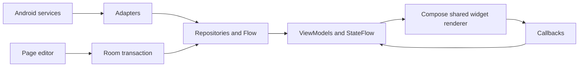

# Architecture contract

The repository has one Android `:app` module with namespace `com.kapav.ridemode`, minSdk 24/targetSdk 36. `RideApplication` and Main/Ride activities use Hilt; a singleton `RideRepository` owns Room layout data and Preferences DataStore. `RideViewModel` exposes their flows as StateFlows and editor/settings commands. `MainActivity` hosts the Navigation Compose graph for Home, Settings, onboarding and permission explanations. Shared `RideScreen` uses a Material 3 top app bar and scrollable content; `RideInfoCard` supplies tonal icon rows, while Settings uses connected expressive toggle buttons for the idle-delay DataStore choice. A dedicated landscape `PageEditorActivity` edits the same saved grid geometry used by Ride. Home launches `RideActivity`, which renders enabled saved pages in a fixed landscape viewport and requests PiP on supported Android. A fresh launch reads DataStore before deciding whether to overlay the brief Ride startup sequence; notification reopen and lifecycle return skip it. The dashboard is rendered underneath the touch-consuming animation. The in-process `RideSession` posts one ongoing notification with Open and End Ride actions; End Ride cancels it. M2 music, volume, weather, system Calls, a bounded notification feed and in-app Google Maps are implemented pending device acceptance; other M2/M3 adapters remain planned. [PRD](PRD.md#detailed-behavior-and-edge-cases-source-4-14-16) governs requirements.

```
app/src/main/java/com/kapav/ridemode/
  MainActivity.kt  RideApplication.kt
  core/model database datastore di permissions ui/theme ui/components util
  core/android/audio telecom notifications maps speech display
  feature/home settings ride pageeditor widgets music contacts calls
  feature/notifications navigation oledsaver assistant
  service/RideMediaListenerService.kt
  data/repository parser local
  domain/usecase contract
```



Room version 1 has `ride_pages(id,name,sort_order,enabled)` and `widget_instances(id,page_id,type_id,x,y,width,height,min_width,min_height,oled_supported,config_json,visible)`, with widget `page_id` cascade deletion. `RideDao` exposes transactional page+widget Flow reads; `RideRepository` validates registry type, size, bounds and overlap before writes, and updates a page without deleting its widgets. Its seed inserts six templates only into an empty database; untouched legacy vertical seeds are repacked once only when their IDs and positions exactly match. On an existing database, saved Weather widget instances are converted to Clock in place while retaining their IDs, grid placements, visibility and config; no schema version change is needed. Schema JSON is exported in `app/schemas`. Preferences DataStore stores keep-awake, saver enable/delay/outline/brightness, the default-on Ride startup animation and show_maps_shortcut switches, reduced motion, popup, privacy and grid-row-height overrides; defaults are supplied in Kotlin, not rewritten on app update. No migration exists beyond database version 1; later schema changes require explicit migrations. No call or notification content table is added: Calls queries the system log while Ride/editor is visible; the listener holds only a bounded current notification feed in memory.

`WidgetRegistry` maps 12 active catalog IDs to min/default/max grid sizes; docs validation compares IDs/sizes, Music's square-or-landscape rule, Volume's one-cell-axis rule and Battery's fixed two-cell axis with proposed JSON. `WidgetCard` is shared by editor and Ride, with explicit mock labels for M2/M3 features and local battery display. Turn guidance uses `TurnGuidanceRepository` and a dedicated widget; Assistant uses a dedicated native handoff widget; dormant preview types remain unused in `PlannedWidgets.kt`. Calls and Notifications now route to dedicated native-backed list widgets with one vertical scroll child each. Both register 4×5 minimum, 6×5 default and device-column×24 catalog maximum, clamped to device rows; older undersized saved placements show a resize prompt. Calls/Notifications show permission, empty and content states; Turn guidance displays access, inactive, current and stale states; Assistant invokes the configured system assistant. `WidgetCard` receives live guidance directly from Ride/editor state and uses the same inert Assistant renderer in the editor. Clock (minimum 2×1) routes to a dedicated surfaced `ClockWidget` with local time, centered thin wide Roboto Flex day/date and live/cached condition-mapped weather; the former separate Weather type is retired from the add sheet and new templates. Music routes to a dedicated responsive `MusicWidget` with a bounded, centrally grouped song/artist block: its full-width low-opacity primary metadata surface is drawn behind a separate rounded square cover tile at left, with text inset to the right; equal-width controls fill the remaining height and Android media-session state drives play/pause after listener access is granted. The center is a filled Material button whose shape animates with actual playing state. The registry permits Music from 5×4 to 12×12 where width is at least height, including square placements; the repository and editor also clamp to device rows. Volume routes to `VolumeWidget`, with live `STREAM_MUSIC` state from `VolumeRepository`, two detached primary-colored segments with an animated boundary and wide title counter, while tap/drag writes actual bounded system volume outside editor mode. The repository observes system settings and audio-device changes, and Ride/editor refresh on resume; Android owns route selection. The editor canvas is read-only. A singleton `WeatherRepository` supplies the combined Clock and both OLED styles. It requests only foreground coarse network location while Ride/editor is resumed (15-minute/10-km bounds), uses a last-known fix, quantizes coordinates to 0.1° for Open-Meteo HTTPS, and stores one rounded-location result for at most two hours. Stable locations fetch every 30 minutes; failures retry with 1/5/15/30-minute backoff and network return can wake retry. On pause, location and network callbacks stop. Missing grant, disabled provider, no fix, expired cache or bad response resolves to a CloudLightning error presentation. The registry accepts only N×1 or 1×N (N≥2), passes the saved grid orientation to the renderer, and clamps max width/height to device columns/rows. `RideGridConstraints` derives device-wide square grid dimensions from landscape canvas width/height and the selected 52/60/68 dp preferred side, with at least twelve columns and six rows. The 52 dp Pixel 8a six-row baseline is the minimum cell side on larger screens; smaller screens reduce the side only to keep minimum counts. Extra whole columns and rows are allowed, including odd counts. Repository bounds and editor/Ride consume the same dimensions. Both renderers use one square cell side for x and y and center the grid horizontally, preserving saved coordinates. On startup `RideRepository` fits overflowed saved widgets to the largest valid size and nearest free cell without deleting their IDs/settings; unfit records remain for a manual Fit to grid action. `WidgetRegistry.rotatedPlacement` swaps valid width/height and searches the nearest empty cell; the repository rechecks and saves it atomically without displacing neighbors. `GridLayout` supplies device-column geometry, overlap/bounds checks and a displaced-widget placement proposal. `RideRepository.placeWidget` applies a single displacement and the move in one Room transaction; resize overlaps and multiple collisions are rejected. The editor uses the fixed device-derived row boundary, dotted grid, all-edge resize handles and a blurred-background add-widget sheet. New instances search valid geometry from smallest area upward. `FixedRideCanvas` maps saved coordinates into the landscape viewport without scrolling using each saved rectangle even when only one widget is visible. Other widget-specific settings UI and visual contracts remain open, although per-instance JSON is stored.

Speedometer, Battery, Maps shortcut and SOS favorites route through dedicated renderers rather than the generic card. `BatteryWidget` reads local capacity and listens to the system battery broadcast only while composed, then renders a split level surface and shifts its text to the side with room and shows a charging icon when plugged in; it falls back to a labeled mock value if capacity is unavailable. It accepts only 2×N or N×2 (N≥4), choosing vertical or horizontal split drawing from the saved grid shape; older incompatible placements remain saved with a resize prompt. `MapsShortcutWidget` renders the filled icon/title preview without an Intent in M1. `SosFavoritesWidget` renders up to six selected contact snapshots, photos/initials and confirmed dial actions. Its width-and-height grid solver and vertical scroll keep all favorites reachable. Speedometer uses a dedicated adaptive renderer; Maps shortcut handoff remains planned. No new service, dependency, permission or Room schema is added.

The existing user-granted listener now also passes current notification posts/removals/ranking to `NotificationFeedRepository`. It keeps at most 50 active entries in memory, displays messages first and only high-importance other alerts, and exposes ten visible rows with avatar/initials, sender and two-line text. Revocation clears content. `CallHistoryRepository` queries five system Recents with cached names, numbers and type/date while Ride/editor is resumed, observes log changes and clears on pause. `CallHistoryWidget` confirms a direct call and requests CALL_PHONE; emergency numbers use the system dialer. READ_CALL_LOG is hard restricted and this private-APK manifest cannot be Play-published as-is. The Maps cue adapter accepts only recognizable ongoing Google Maps notifications, stamps observation time, expires after two minutes and emits explicit inactive/listening/current/stale/unavailable states. It does not fabricate directions. Service cannot require Activity lifetime; revocation clears dependent state.

Permissions are requested at use. No foreground service keeps UI alive. `RideActivity` uses manifest sensor-landscape orientation, requests hidden system bars, honors keep-awake only while resumed, and finishes on End Ride. Android can show system bars for an active call. Ride's OLED saver uses the selected idle delay, black overlay, first-touch interception and automatic per-window brightness reduction with an extra dim tier; wake/pause/PiP restore system brightness. OledBrightness policy gates window overrides to resumed non-PiP saver state, and content attenuation over black preserves the tier difference on panels that clamp low brightness. Saver/preference/resume/PiP changes reapply the policy. The persistent assistant rail button opens simulated states only. Pixel 8a saver timing and first-touch behavior remain to be verified. Maps launches foreground via Intent and returns via task history in M2; optional overlay needs separate permission and decision. M3 assistant pipeline: tap → offline recognizer capability/model check → local recognition → deterministic parser → permission-aware dispatcher → optional TTS; no cloud fallback.

The M1 Ride rail keeps three page names visible around the current page and animates indicator changes as the pager moves; adjacent names use a wide but thin Roboto Flex variant. End ride uses an outlined two-line control, the microphone uses the secondary palette color, and the optional default-on Maps toolbar action opens Google Maps or a browser fallback. OLED has a persisted Classic/Row DataStore choice. Classic stacks clock, live/cached weather or the error state, current media-session song/artist or access/empty state, local battery percentage and wake hint. Row puts enlarged tightly stacked hour/minute/date (solid or outline per Settings) beside three widely spaced 1 dp white-outline black panels for centered icon-led live song state, icon-led live/cached weather or the error state and charging-aware local battery, with the same first-touch wake behavior. Battery still reads the local OS property. The music areas use the same user-granted session source as the widget; weather needs an explicit coarse-location grant for live data. The editor and Ride renderer share an 8 dp widget gap; music session play state drives a 220 ms corner-radius transition on the filled center button.

Boundaries and alternatives: native incoming-call UI remains with Android; call-log feature is policy-gated; weather/Maps/third-party messages are external; screen-off wake gestures are OS-owned. See [capabilities](ANDROID_CAPABILITIES.md) and [decisions](DECISIONS.md).

M2-MEDIA-001: `RideMediaListenerService` supplies the user-enabled component required for `MediaSessionManager.getActiveSessions` and also routes current notifications to bounded feed and Maps cue repositories. Singleton `MediaSessionRepository` observes active sessions and the chosen `MediaController`, publishes metadata, art URI/bitmap, playback state and action flags, and clears state on revocation or disappearing sessions. `RideViewModel` exposes this flow to Ride, editor preview and both OLED music areas; only Ride dispatches supported transport controls. Settings opens Android notification-listener access. The saver overlays the normal Ride UI with a 350 ms fade in both directions; Reduce motion makes it immediate. M1 device acceptance remains open by user direction.

M2-TURN-001: `TurnGuidanceRepository` accepts only ongoing notifications from the Google Maps package with a recognizable maneuver in standard text extras. It retains bounded text and the source PendingIntent in memory, exposes one current cue to Ride/editor, schedules a one-shot two-minute expiry and clears on removal, listener disconnect or revoked access. The widget distinguishes unavailable/listening/inactive/current/stale, shows original instruction plus available route details, and opens the notification intent or Maps on tap. Maps has no guaranteed public notification schema; locale, style and version variation may produce no cue. The separate Maps shortcut and route handoff are still planned.

M2-NAV-001: `GoogleMapsController` owns one Activity-scoped map/search/navigation state per widget ID. `GoogleMapsWidget` hosts one lifecycle-managed NavigationView that resizes between its saved rectangle and the full grid; `FixedRideCanvas` animates the same map position/size and hides other cards during expansion and collapse. `RideDashboard` adds the Grid rail control and disables page navigation while expanded. Places SDK (New) runs India-restricted, delayed autocomplete with cancellation/generation guards and a minimal selected-place Details call; the full-window Compose Dialog hosts destination search outside the square-cell grid, consumes keyboard/system-bar insets once and suspends the saver timer while open. Search keeps From fixed to Current location, expands To with the keyboard, and restores the pair on selection/Back. To can also use a camera-center map pin with coordinate waypoint; the point-only Review ride confirmation does not request a route. `Navigator.setDestination` is invoked only by Start navigation, and guidance is cleared on arrival, explicit stop or End Ride. The SDK ETA card stays hidden; after guidance starts, one Navigator remaining-time/distance listener feeds a bottom-attached single-line progress footer with a same-height End action and reserved map padding. The SDK turn header is shown only while expanded, and compacting restores follow-camera mode. The external-notification Turn guidance widget and every other widget retain their source and state. The editor renders a static placement preview. Precise foreground location is requested at use. Idle recenter uses recent cached fixes and sequential bounded one-shot fused/network/GPS lookup, canceled on detachment or a new request; real-device confirmation of the correction, route, lifecycle and permission behavior remain open. See [M2-NAV](../tasks/M2-NAV.md).

M2-NAV lifecycle refinement (ADR-053): controller-owned voice mode and stop-confirmation deadline survive widget resizing. A five-second CoroutineScope job uses elapsed realtime; Back/collapse/pause/end cancels it. Confirmation keeps MapStage.NAVIGATING; confirmed stop enters STOPPING and disables SDK navigation UI before ordered stopGuidance/clearDestinations/cleanup through the tested MapNavigationCleanup helper. Teardown failure retains Retry end; success resets map padding/default location source and a north-up/zero-tilt current-location camera, preserving expanded size. SDK UI changes and Activity permission refresh detect ended guidance; arrival, route failure, permission loss and finishRide share teardown. Stale navigator-ready callbacks do not stop a newer request. QUIT_SERVICE handles SDK task removal. No polling, new service, permission, dependency or persistent setting is added.

Ride quality-of-life (ADR-054): HorizontalPager uses stable page IDs and settledPage for the active map controller. Each composed page retains its controller; FixedRideCanvas gates the first native view on a settled/non-scrolling page plus one frame, and loaded GoogleMapsWidget views are made invisible during swipes instead of recreated. CircularWavyProgressIndicator covers the waiting/native-ready states. End Ride uses a full-screen five-second confirmation and the shared core/util ConfirmationTimer monotonic calculation; timeout/Keep/Back/resume/PiP cancel, timely confirmation uses existing Activity cleanup. DataStore show_maps_shortcut defaults true and Settings/RideViewModel update it without migration. ExternalMaps launches the Maps app via package-targeted URL with browser fallback. PermissionInfoScreen routes short capability cards to supported Android settings actions and falls back safely. Native performance, permissions-link and preference restart acceptance remain open.

Widget readability (ADR-055): WidgetCard passes saved grid height to ClockWidget, hiding weather below three rows; WidgetRegistry/JSON allow 2×1 and legacy Weather conversion reads the registry minimum. BatteryContentPlacement fits independent percentage/power-icon slots in a logical fill axis; Canvas rotates the same bar geometry for portrait while keeping text upright. Per-item contrast follows its selected region. NotificationFeedWidget formats existing postedAtMs locally only when positive; no repository/parser/storage/permission change is needed. Speedometer/lean telemetry were assessed only: no sensor pipeline or new registry type exists.

### Speedometer and SOS integration — 2026-11-20

ADR-057 adds a singleton foreground SpeedRepository driven by RideActivity resume/pause and enabled/visible speed-widget presence. One GPS request feeds a StateFlow collected inside speed widgets, avoiding a dashboard-wide GPS recomposition. Generation guards reject late callbacks after refresh/stop; monotonic fix age expires values in five seconds. No route-engine dependency or coordinate history. Editor preview never starts GPS. Units persist in existing DataStore; override/status persist in WidgetInstance.configJson.

ADR-058 replaces SOS mock content with exact-widget JSON snapshots. System contact/photo picker reads and thumbnail processing happen on IO, then update the dialog's widget-scoped draft. Save uses the captured widget ID, not current page position. Existing widget/page duplication copies serialized config rather than sharing mutable contact lists. Dialog Cancel changes no database rows. Actual calling uses the common validated dialer/direct-call helper, never a provider URI or arbitrary intent from contact data. Existing Room schema and backup policy are unchanged.

ADR-059 shares core RideConfirmation UI across SOS, Recents, Ride end and navigation stop. GoogleMaps state exposes its existing stop deadline for exact progress without extra timers/services; existing controller expiry/confirmation guards remain authoritative. The confirmation component uses a monotonic deadline, one-shot resolution latch and latest dismissal callback; only its dismiss button reads frame time, with derived integer seconds for text/semantics. Call confirmation stores an explicitly confirmed pending number separately before launching Android permission, preventing a timed dialog from clearing the permission result target. No calling policy/schema/source changes.

ADR-060 replaces RideStartupAnimation presentation with fixed-layout titleLarge RIDE plus a measured HARD/SAFE word slot, sequential alpha layers and a whole-overlay upward translation. The bottom single-line warning/advice uses available safe-area width. RideActivity still owns fresh-start/preference/Reduce motion/reopen/PiP/lifecycle gates and already renders the dashboard underneath; the outer input shield stays until completion. No new state persistence or integration.

ADR-062 changes only intro geometry: visibility-independent system-bar/cutout insets replace live safeDrawing padding, and cached fitted advice width keeps the centered warning row stable through phase changes and the existing graphics-layer reveal. Existing user title sizing, timing and lifecycle ownership are preserved.

### Navigation ownership across configuration changes — ADR-063

RideNavigationViewModel now owns per-widget GoogleMapsControllers through Activity recreation. Controllers use application context for services/Places and a weak, replaceable Activity only for getNavigator; native NavigationView/GoogleMap references are transient and invalidated at detach. RideActivity no longer ends navigation when isChangingConfigurations is true; actual End Ride/onCleared performs final teardown. Native configuration/save/trim callbacks are forwarded as well as lifecycle events. Palette resources can therefore refresh by ordinary Activity recreation instead of broad manifest suppression.

Application-singleton NavigationSdkSession holds the Navigator resource without Activity/View references. NavigationSessionGate issues monotonic ride/route leases, allowing one active map widget route at a time and rejecting stale callbacks. Stop/arrival/permission loss removes route listeners, calls stopGuidance and clearDestinations, and restores idle once; cleanup is deferred to true Ride end while the idle map still uses the SDK. The UI-change callback never recenters or resets a location source. Map operation failures invalidate the handle and request one view-generation replacement, followed by explicit Reload map if failures persist; guidance itself remains retained. Unsupported setLocationSource(null) removed. Runtime exceptions are logged/recoverable; SDK internal deadlocks cannot be caught this way.

ADR-065 applies the explicitly approved SDK 6.3.3/Kotlin 2.1.21 update for documented native deadlocks; real-device stress acceptance remains open. Process death/force-stop cannot preserve an in-memory Navigator and does not auto-issue a replacement route. No new permission or dependency version was introduced by the ownership repair.

The background End Ride notification receiver is Hilt-injected with the same application SDK owner and ends it directly before clearing RideSession, so cleanup is independent of Activity recomposition. RideTheme observes LocalConfiguration when caching dynamic palettes; palette refresh does not key or replace route ownership. No new service or permission is introduced.

ADR-066 adds a small external-assistant launcher using foreground Activity.showAssist with empty explicit args; Android chooses the current default assistant. No provider query, microphone permission or recognition service is introduced. The rail prototype is disabled; the widget no longer consumes mock AssistantState. Existing planned command-engine types are dormant future models. WidgetRegistry.pickerWidgets excludes canonical hiddenFromPicker IDs, validated against catalog availableInPicker=false; registry lookup/legacy rendering remain intact. New/reset Touring templates omit the hidden Maps shortcut, leaving saved overrides untouched. TurnGuidancePresentation separates current usable content/deduplication from the renderer; repository notification parsing/access/TTL remain independent from Navigation SDK. Strict Maps handoff reuses the current timed confirmation and shared launch helper without browser fallback; the toolbar keeps its prior fallback.

Widget handoff refinement (ADR-067, ADR-068): MediaSessionRepository publishes the current controller sessionActivity alongside its source package. When music is actively playing, MusicWidget captures an immutable MusicAppTarget when artwork/details is tapped; the existing timed RideConfirmationDialog gates ExternalMusicApp with session activity preference and captured-package launcher fallback. When no music is playing (!playing or no session target), clicking on either container invokes openMusicAppChooser, presenting the native Android "Open with" chooser sheet (Intent.makeMainSelectorActivity with CATEGORY_APP_MUSIC, plus MUSIC_PLAYER and MEDIA_PLAY_FROM_SEARCH initial intents). Targeted manifest queries provide Android 11+ package visibility without broad QUERY_ALL_PACKAGES permission. No new service/permission or stored intent. Android 34+ sender opt-in and Android 36 visible-only mode apply at send. Assistant label/icon grouping is centered. TurnGuidancePresentation separates current arrivalTime from deduplicated supporting details; TurnGuidanceWidget renders it bottom-center while keeping the same explicit Maps confirmation.

Confirmation presentation (ADR-071): the existing Compose Dialog remains the modal window for call/app handoffs, with transparent content and explicit window dim amount from RideUiTokens. It no longer wraps RideConfirmation in a card. End Ride and navigation stop use translucent full-coverage Surfaces; map visibility and accessibility coverage are separate so the map remains visible but inaccessible under stop confirmation. End Ride no longer hides the settled page map via the initialization/render gate, keeping the actual dashboard visible beneath dimming. Controller ownership and deadline/action semantics are unchanged.

Home grid correction (ADR-073): only the lower four existing RideInfoCard rows are arranged in width/font-scale-aware columns inside RideScreen's scroll owner. Original Home hero/copy and shared card implementation are restored; no active-session presentation parameter or wide split remains.

Confirmation fades (ADR-073): FadeRideConfirmation stays mounted at each existing confirmation site and retains only the outgoing prompt while its Compose transition completes. Content alpha drives native window dim amount for modal prompts and graphics-layer alpha for inline prompts. Outgoing controls are disabled and semantics cleared; domain dismissal/deadlines still belong to their existing callers/controllers. RideActivity/PageEditorActivity supply persisted Reduce motion through a presentation CompositionLocal. End Ride validates confirmation before fading and invokes the existing exit callback when hidden. No new service, persistence or architecture owner.
