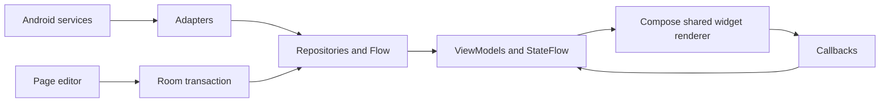

# Architecture contract

Planned architecture from [PRD](PRD.md#detailed-behavior-and-edge-cases-source-4-14-16). The repository has one Android `:app` module with namespace `com.kapav.ridemode`, minSdk 24/targetSdk 36. M1 foundation has a Compose `MainActivity`, theme, shared UI components, and a Navigation Compose graph in `core/navigation/RideApp.kt` for Home, Settings, onboarding and permission explanations. The screens receive navigation callbacks, not a controller. Home launches a dedicated `RideActivity`; it presents a dark landscape Compose preview with three static pages and an action rail. Hilt, Room, DataStore and the remaining package layout are planned, not implemented.

```
app/src/main/java/com/kapav/ridemode/
  MainActivity.kt  RideApplication.kt
  core/model database datastore di permissions ui/theme ui/components util
  core/android/audio telecom notifications maps speech display
  feature/home settings ride pageeditor widgets music contacts calls
  feature/notifications navigation oledsaver assistant
  service/RideNotificationListenerService.kt
  data/repository parser local
  domain/usecase contract
```



Room entities planned: RidePage(id,name,order,enabled), WidgetInstance(id,pageId,type,x,y,width,height,config,visible), selected contact reference and any bounded local notification metadata justified at M2. DataStore keys planned: keepAwake, saverEnabled, saverDelayMs, outlineText, reduceBrightness, popupEnabled, privacyMode, notification priority overrides and page preference. Store user overrides separately from defaults, with migrations; app updates must not reset preferences. No schema or key is active yet.

Widget registry maps stable catalog type IDs to a shared Compose renderer, size validator and settings schema. Editor and Ride pass immutable state and callbacks to the same component. A 12-column grid clamps bounds; collision resolution is editor-only. [Catalog](WIDGET_CATALOG.md) is proposed until code validation exists.

NotificationListenerService (M2) normalizes only available fields, processes updates/removals, applies priority and redaction, then emits bounded local events. Separate Maps adapter accepts only confident Google Maps cues, stamps observation time, expires by conservative TTL and emits explicit inactive/listening/guidance/stale/unavailable states. It does not fabricate directions. Service cannot require Activity lifetime; revocation clears dependent state.

Permissions are requested at use, exposed as observable state and checked again at action time. No foreground service is planned merely to keep UI alive. `RideActivity` uses manifest sensor-landscape orientation, requests hidden system bars, sets `FLAG_KEEP_SCREEN_ON` in `onResume`, clears it in `onPause`, and finishes on End Ride so MainActivity resumes in the user's prior orientation. Android can show system bars for an active call. Preview pages are static until editor/Room work supplies enabled pages. Saver lifecycle remains planned. Maps launches foreground via Intent and returns via task history in M2; optional overlay needs separate permission and decision. M3 assistant pipeline: tap → offline recognizer capability/model check → local recognition → deterministic parser → permission-aware dispatcher → optional TTS; no cloud fallback.

Boundaries and alternatives: native incoming-call UI remains with Android; call-log feature is policy-gated; weather/Maps/third-party messages are external; screen-off wake gestures are OS-owned. See [capabilities](ANDROID_CAPABILITIES.md) and [decisions](DECISIONS.md).
